  

  

  

<b>os 20 sistemas, um por linha</b>

 

| Sistema | O que faz | Feito com |
|---|---|---|
| ALIFLEET | Plataforma de frota com gateways próprios (GT06, Teltonika, Suntech, JT808), mapa ao vivo, vídeo das câmeras, app do motorista e assistente com IA | TypeScript, React, Bun, PostgreSQL, TimescaleDB, Redis, AWS, Terraform |
| Argos Hub | Atendimento e disparo no WhatsApp, fluxos de conversa montados sem código, agentes de IA, cobrança por boleto e agenda | React, Supabase, Deno, React Flow, WhatsApp |
| SOF.IA BDR | SDR que conversa no WhatsApp: cadência, follow-up, áudio, reunião marcada no Cal.com e o Pipedrive em dia | Supabase Edge Functions, OpenAI, WhatsApp, Pipedrive |
| Orçamentos | Monta o projeto de videotelemetria, consulta o CNPJ, calcula frete nos Correios e DIFAL, passa por aprovação e gera a proposta em PDF | React, Supabase, jsPDF |
| Central de comandos | Comandos em lote para os rastreadores da frota, com modelos, monitor e um robô que repete o que falhou | TanStack Start, Supabase, Node |
| Integrações | Puxa Wialon, Fulltrack, Getrak e Systemsat para um data warehouse e dispara reativação por ligação e WhatsApp | Supabase Edge Functions, ETL |
| Abastecimento offline | App Android que registra abastecimento sem sinal, com QR code e fila local, e sincroniza quando a rede volta, mais o painel de gerência | Capacitor, IndexedDB, ML Kit, Supabase |
| Check Drive | Checklist de veículo no celular, com modelos prontos, histórico de cada veículo e gestão | Capacitor, Supabase, Framer Motion |
| Rede de técnicos | Cadastro e credenciamento de instaladores, indicações e mapa do Brasil com localização por CEP | React, Leaflet, Supabase |
| Infranet | Transcreve as ligações do softphone com IA e guarda o histórico para consulta | OpenAI, Supabase |
| Gestão de frota | Painel sobre o Wialon: consumo, condução, pontuação do motorista, alerta com impacto financeiro e replay da rota | TanStack Start, Leaflet, Supabase |
| Portfólio 8-bit | Portfólio interativo em estilo retrô 8-bit, com cidade em pixel e cada projeto numa janela | React, Framer Motion |
| Ponto eletrônico | Controle de ponto: cada pessoa liga e desliga o próprio cronômetro | React, Supabase |
| Painel de fretes | Motoristas, viagens e rentabilidade da frota | React, Recharts |
| Configurador de câmeras | Agiliza a configuração das câmeras embarcadas | React, Supabase |
| Loja de velas | Loja virtual de velas artesanais | React, Tailwind |
| Mapa de técnicos | Mapa interativo com os técnicos espalhados pelo Brasil | React, Leaflet, Supabase |
| Contratos e placas | Consulta interna de contratos e placas por cliente | React |
| Leads no WhatsApp | Recebe as conversas do WhatsApp e organiza os leads | React, Supabase, Z-API |
| Sincronia SSX | Puxa clientes e veículos de uma plataforma de rastreamento para a base | Supabase Edge Functions |

  

  

  

